<div align="center">



<a href="https://github.com/YOUR-USERNAME">
  
</a>

<br>

[](mailto:WRITE-YOUR-EMAIL-HERE)
[](WRITE-YOUR-LINKEDIN-LINK-HERE)
[](https://github.com/YOUR-USERNAME/ml-internship-projects)


</div>

> [!NOTE]
> 🟢 **Open to work:** I am looking for an entry-level **machine learning** or **data analysis** role. Remote or on-site.

## 👩‍💻 About me

```python
class ZoyaAli:
    role      = "Aspiring ML engineer and data analyst"
    education = "Bachelor's in Computer Science"
    languages = ["Urdu", "English"]
    works_with = ["Python", "scikit-learn", "TensorFlow / Keras", "pandas"]
    internship = "Machine learning: regression, CNN, imbalanced data"
    final_year_project = "AI fleet tracking and dispatch (TapTrack)"
    learning   = ["Deep learning", "Model evaluation", "Data analysis"]
    values     = "Honest results: clean splits, many metrics, clear limits"
    looking_for = "My first ML or data role"
```

## ✨ Featured work: Machine Learning Projects

Three projects from my ML internship. Every notebook runs in Google Colab, with the results and the limits written in the README.

<table>
<tr>
<td width="50%" align="center">
<b>🔢 CNN on MNIST: 99.42% test accuracy</b><br>
<br>
<sub>Training and validation curves stay close together, so there is no overfitting.</sub>
</td>
<td width="50%" align="center">
<b>🚗 Ridge regression: R² 0.93 on car prices</b><br>
<br>
<sub>Predicted price against real price on 41 test cars.</sub>
</td>
</tr>
</table>

| Project | What I did | Tools |
|---|---|---|
| 🚗 [**Ridge regression pipeline**](https://github.com/YOUR-USERNAME/ml-internship-projects/tree/main/task2-ridge-regression) | Predicted car prices with imputation, scaling and one-hot encoding in one pipeline. Tuned alpha with 5-fold cross-validation. | scikit-learn, pandas |
| 🔢 [**CNN on MNIST**](https://github.com/YOUR-USERNAME/ml-internship-projects/tree/main/task3-cnn-mnist) | Built a CNN with data augmentation, dropout and early stopping. 58 wrong out of 10,000 test images. | TensorFlow, Keras |
| 🏥 [**Clinical risk predictor**](https://github.com/YOUR-USERNAME/ml-internship-projects/tree/main/task4-clinical-predictor) | Found high-risk patients in imbalanced data (15% high-risk). Compared SVM, Random Forest and XGBoost, and showed why recall alone can pick a bad model. | imbalanced-learn, XGBoost |
| 🚚 [**AI Fleet Tracking System**](https://github.com/YOUR-USERNAME/AI-Fleet-Tracking-System) | My final year project (TapTrack): AI-based fleet tracking and dispatch. | See the repository |

## 🛠️ Tech stack

**Languages**<br>


**Machine learning and data**<br>


**Tools**<br>


## 🎯 What I am building next

- [x] Regression pipeline with Ridge and cross-validation
- [x] Image classification with a CNN and data augmentation
- [x] Imbalanced classification with SMOTENC, SVM, Random Forest and XGBoost
- [ ] A data analysis project with SQL and a dashboard
- [ ] A Kaggle notebook on a real-world dataset
- [ ] A small model deployed as a web app

## 💡 What drives me

<div align="center">

*"A good model is not the one with the highest number. It is the one you can trust."*

</div>

## 🤝 Let's connect

<div align="center">

I would love to hear about a role, an internship or a project. Reach me by LinkedIn or email:

<br>

[](WRITE-YOUR-LINKEDIN-LINK-HERE)
[](mailto:WRITE-YOUR-EMAIL-HERE)

</div>

<br>

<div align="center">


</div>
